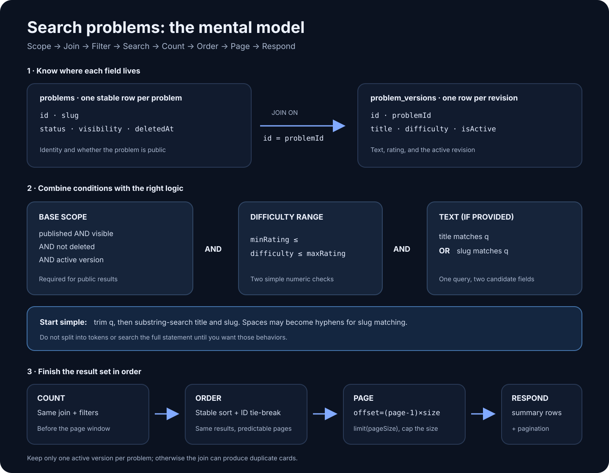

# Search problems: mental model and implementation plan

This note is about how to reason through the search before writing the Drizzle query. The useful sequence is:

> **Scope → Join → Filter → Search → Count → Order → Page → Shape the response**

## First, map the data

In this codebase the “problem detail” data lives in `problem_versions` (the TypeScript table is `problemVersions`). A `problems` row is the stable identity; a version row holds the editable problem content and difficulty.

| Table | One row represents | Search fields relevant to this endpoint |
| --- | --- | --- |
| `problems` | The stable problem identity | `id`, `slug`, `status`, `visibility`, `deletedAt` |
| `problem_versions` | A revision of a problem | `problemId`, `title`, `difficulty`, `isActive` |

The relationship is `problems.id = problem_versions.problem_id`. That join lets one search combine the slug and publication state from `problems` with the title and difficulty from the active version.

One naming wrinkle: the API query is called `minRating`/`maxRating`, while the database field is `difficulty`. If “rating” is the product term, keep those API names and document that they filter `difficulty`. If not, consider `minDifficulty`/`maxDifficulty` before the endpoint becomes a stable public contract.

## Decide what “searchable” means

The route is currently public (`GET /search`). For a public problem list, first restrict the eligible rows to:

- `problems.status = 'PUBLISHED'`
- `problems.visibility = true`
- `problems.deletedAt IS NULL`
- `problem_versions.isActive = true`

These are the baseline scope rules, not optional search filters. They prevent drafts, hidden problems, deleted problems, and old revisions from showing up. Your create flow currently makes a draft hidden by default, so a newly created problem should not appear in public search until it is published and made visible.

If admins later need to search drafts, make that an explicit authenticated/admin mode. Don’t quietly weaken the public route’s rules.

## Treat each query parameter as a predicate

The filters combine in two different ways:

- **AND** between independent filter categories: visibility AND difficulty range AND text match.
- **OR** between places where the same text may be found: title OR slug.

For a request like `?query=two%20sum&minRating=800&maxRating=1600`, the logical condition is:

```text
(published AND visible AND not deleted AND active version)
AND (difficulty >= 800 AND difficulty <= 1600)
AND (title matches "two sum" OR slug matches "two-sum")
```

That last line is the key mental model: one free-text value becomes one **text predicate** across a small, intentional list of searchable fields. It is not necessary to split the words into many database filters for the first version.

## Start with a small text-search rule

For an MVP, trim the input and use a case-insensitive substring match on:

1. `problem_versions.title`
2. `problems.slug`

For a slug, spaces can be changed to hyphens, so `two sum` can also match `two-sum`. Do not search the full statement at first: it is long content, and matching arbitrary snippets can make results noisy and slower. Add PostgreSQL full-text search later if searching problem statements becomes a product requirement.

In SQL terms, the text part looks like:

```text
ILIKE(title, "%two sum%") OR ILIKE(slug, "%two-sum%")
```

Escape user-provided `%`, `_`, and backslash characters before putting text inside a `LIKE` pattern; those characters have special pattern meaning. Parameterized Drizzle conditions protect SQL syntax, while this escaping controls wildcard behavior.

If you later want all words to match, then tokenize on whitespace. For `shortest path graph`, a useful rule is:

```text
(title or slug matches "shortest")
AND (title or slug matches "path")
AND (title or slug matches "graph")
```

That is a deliberate future behavior choice. Begin with the whole trimmed phrase because it is easier to understand and debug.

## Build the query in layers

### 1. Normalize and validate input

Your Zod schema already coerces the numeric query parameters and supplies defaults (`minRating=800`, `maxRating=3500`, `pageNumber=1`, `pageSize=20`). Normalize the optional text with `trim()` and treat an empty-after-trimming string as no text filter. Add a maximum page size, such as 100, so a caller cannot request an enormous result page. The schema currently checks that page size is positive but does not cap it.

### 2. Join the stable problem row to its active version

Start from `problems`, inner-join `problemVersions` on `problems.id = problemVersions.problemId`, and keep the active version. The join is necessary because slug/publication fields and title/difficulty live on different tables.

### 3. Assemble the `WHERE` clauses

Think of the query as a list of conditions, not one giant SQL string:

```ts
const conditions = [
  // public, live problem scope
  eq(problems.status, "PUBLISHED"),
  eq(problems.visibility, true),
  isNull(problems.deletedAt),
  eq(problemVersions.isActive, true),

  // difficulty range
  gte(problemVersions.difficulty, query.minRating),
  lte(problemVersions.difficulty, query.maxRating),
];

// If there is text, append one condition equivalent to:
// title ILIKE pattern OR slug ILIKE normalizedSlugPattern

const where = and(...conditions);
```

The text condition is an OR group inside the overall AND list. This layout mirrors the product rules and makes optional filters straightforward to add later.

### 4. Count before paginating

Run a count query using the exact same join and `where` conditions, before applying `limit` and `offset`. That count answers “how many results match?”; the page query answers “which slice should I return?” Reusing the same conditions prevents the count and the results from disagreeing.

### 5. Sort, then apply the page window

Pick a default sort that makes sense for the product (for example, title ascending, or newest first), and add a unique tiebreaker such as problem ID. Stable ordering matters: without it, rows can move between pages. Calculate:

```text
offset = (pageNumber - 1) * pageSize
totalPages = ceil(totalMatchingProblems / pageSize)
```

Then apply `limit(pageSize)` and `offset(offset)` to the result query.

### 6. Select only the fields the list needs

Return summary fields such as `id`, `slug`, `title`, and `difficulty`. Avoid selecting every column from `problem_versions`: test-case object keys and checker-script keys are implementation details and should not be sent in a public search response.

The controller already expects the service result to look like:

```ts
{
  problems: [/* summary rows */],
  pagination: {
    pageNumber,
    pageSize,
    totalItems,
    totalPages,
  },
}
```

## One data-integrity detail to settle

`isActive` is a boolean on each version, but the schema does not currently guarantee that only one version per problem can be active. The join assumes one active version per problem. Keep that invariant true when publishing a revision (deactivate the old version and activate the new one in one transaction), and consider a database constraint/index that enforces at most one active version per `problem_id`. Otherwise the search can return duplicate problem cards and inflate the count.

## Keep performance simple at first

For a small problem set, `ILIKE '%text%'` is a reasonable starting point. A normal B-tree index generally will not speed up a pattern that begins with `%`. If the table grows and this search gets slow, add a PostgreSQL trigram index for title/slug substring search, or use full-text search when searching long statements. Do not add that complexity before you have a need for it.

## Implementation checklist

1. Decide the public visibility rules and the default sort.
2. Add a maximum `pageSize` and trim the text input.
3. Build the active-version join.
4. Add the baseline scope and difficulty range with AND.
5. If `query` exists, add `(title match OR slug match)`.
6. Use identical conditions for the count and page queries.
7. Order deterministically, then limit/offset.
8. Select and return only list-safe fields plus pagination metadata.
9. Keep one active version per problem as a database-backed invariant.


